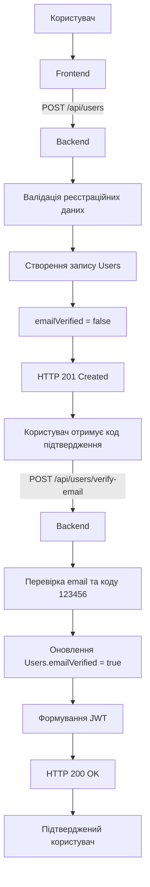

# SYS-API-01 — Реєстрація та підтвердження облікового запису

**Тип документа:** System Analysis / Functional & Technical Specification  
**Ідентифікатор:** SYS-API-01  
**Функціональний модуль:** Users / Authentication

## Загальний опис

Функціонал призначений для створення облікового запису користувача з обов'язковим підтвердженням електронної пошти перед наданням доступу до системи.

Процес реєстрації складається з двох послідовних етапів. На першому етапі Backend приймає реєстраційні дані, виконує їх валідацію та створює новий запис у таблиці `Users` зі статусом непідтвердженої електронної пошти (`emailVerified = false`). На другому етапі користувач підтверджує адресу електронної пошти за допомогою коду `123456` (статичне значення для тестового середовища).

Після успішної верифікації Backend оновлює стан облікового запису та повертає JWT із базовими правами звичайного користувача.

**Основне бізнес-правило:** користувач із непідтвердженою електронною поштою не повинен мати можливості авторизуватися в системі.

## Архітектура та послідовність взаємодії



Обидва API-запити повинні супроводжуватися відповідним логуванням. Ідентифікатор запиту (`requestId`) використовується для кореляції операцій.

## API-контракт та обробка вхідних параметрів

### Створення облікового запису

**Endpoint:** `POST /api/users`  
**Content-Type:** `application/json`  
**Authorization:** не потрібен.

**Заголовки запиту:**

| Параметр | Обов'язковість | Призначення |
|---|---|---|
| Host | За HTTP-протоколом | Адреса сервера |
| Content-Type | Так | Формат тіла запиту — `application/json` |
| X-System-Code | Так для клієнтських викликів | Фронтенд автоматично надсилає `front`; бекенд підставляє `front`, якщо заголовок відсутній. Інші передані значення приймаються й додаються до логів |
| X-Request-Id | Ні | Ідентифікатор запиту для трасування та кореляції логів |
| Authorization | Ні | Для створення облікового запису не використовується |

**Request Body:**

```json
{
  "user": {
    "username": "alex",
    "email": "alex@example.com",
    "password": "Example!234",
    "bio": "Коротко про мене",
    "image": "https://example.com/avatar.png"
  }
}
```

**Опис параметрів та правила збереження:**

| Параметр | Тип | Обов'язковість | Призначення та правила | Збереження |
|---|---|---|---|---|
| user | Object | Так | Контейнер реєстраційних даних. Сторонні ключі не допускаються | — |
| username | String | Так | Ім'я користувача, унікальне, 3–40 символів; починається з латинської літери, далі лише латинські літери й цифри. Regex: `/^[A-Za-z][A-Za-z0-9]{2,39}$/` | `Users.username` |
| email | String | Так | Унікальна адреса, не більше 254 символів. Regex: `/^(?!.*[._+-]{2})[A-Za-z0-9._+-]+@[A-Za-z0-9](?:[A-Za-z0-9-]*[A-Za-z0-9])?(?:\.[A-Za-z0-9](?:[A-Za-z0-9-]*[A-Za-z0-9])?)+$/` | `Users.email` |
| password | String | Так | 8–30 символів ASCII; щонайменше одна велика латинська літера, цифра й спеціальний символ. Regex-умови: `/[^\x20-\x7E]/` не має збігатися; `/[A-Z]/`, `/[0-9]/` і `/[^A-Za-z0-9\s]/` мають збігатися. У БД записується bcrypt-хеш | `Users.password` |
| bio | String | Ні | Якщо передане, має бути рядком довжиною до 9000 символів; `null` приймається і зберігається як `null` | `Users.bio` |
| image | String | Ні | Якщо передане, має бути рядком до 2048 символів і валідним URL з `http:`/`https:` або data URL із префіксом, що відповідає regex `/^data:image\//i`. `null` приймається | `Users.image` |

Унікальність `username` та `email` забезпечується окремими унікальними індексами на рівні бази даних. Повторне використання цих значень не повинно призводити до створення дубліката користувача.

Після успішної обробки запиту Backend створює запис у `Users`. Поле `emailVerified` встановлюється в `false`. Код підтвердження в БД не зберігається, оскільки в тестовому середовищі використовується статичне значення.

**Успішна відповідь — HTTP 201 Created:**

```json
{
  "user": {
    "username": "alex",
    "email": "alex@example.com",
    "verificationRequired": true
  },
  "requestId": "<uuid>"
}
```

| Параметр відповіді | Тип | Опис |
|---|---|---|
| user.username | String | Ім'я створеного користувача |
| user.email | String | Електронна адреса |
| user.verificationRequired | Boolean | Ознака необхідності підтвердження email |
| requestId | UUID | Ідентифікатор запиту |

На цьому етапі JWT не видається, оскільки обліковий запис ще не підтверджений.

### Підтвердження електронної пошти

**Endpoint:** `POST /api/users/verify-email`  
**Content-Type:** `application/json`

| Заголовок | Обов'язковість | Правило |
|---|---|---|
| Host | Автоматично | Адреса API-сервера |
| Content-Type | Так | `application/json` |
| X-System-Code | Так для фронтенду | Frontend передає `front`; за відсутності backend підставляє `front`; інші значення приймаються й логуються |
| X-Request-Id | Ні | UUID кореляції; за відсутності генерується backend |
| Authorization | Ні | Підтвердження email доступне без авторизації |

**Request Body:**

```json
{
  "email": "alex@example.com",
  "code": "123456"
}
```

| Параметр | Тип | Обов'язковість | Призначення та правила | Збереження |
|---|---|---|---|---|
| email | String | Так | Адреса електронної пошти облікового запису; ті самі тип, обмеження довжини та regex, що й під час реєстрації | Використовується для пошуку `Users.email` |
| code | String | Так | Шість цифр; формат перевіряється regex `/^\d{6}$/`, а в тестовому середовищі значення має дорівнювати `123456` | Не зберігається |

Backend перевіряє відповідність email та коду підтвердження. Якщо перевірка успішна, поле `Users.emailVerified` змінюється на `true`.

**Очікувана відповідь — HTTP 200 OK.**

Відповідь містить об'єкт користувача та JWT із базовими правами звичайного користувача. Точна структура JSON-відповіді, назва поля токена, claims та строк його дії в наданій специфікації не визначені.

## Збереження даних та особливості моделі User

Відповідно до наданої Sequelize-моделі `User`, таблиця містить такі основні поля:

| Поле | Тип Sequelize | Призначення |
|---|---|---|
| email | STRING | Електронна адреса користувача |
| username | STRING | Унікальне ім'я користувача |
| bio | TEXT | Інформація про профіль |
| image | TEXT | Посилання на зображення |
| password | STRING | Хеш пароля |
| emailVerified | BOOLEAN | Стан підтвердження електронної пошти |

Для `email` та `username` визначені окремі унікальні індекси. Поле `emailVerified` має обмеження `allowNull: false`. Також модель використовує стандартні часові поля Sequelize `createdAt` та `updatedAt`.

**Виявлена невідповідність у реалізації:**

У наданому коді Sequelize визначено:

```javascript
emailVerified: {
  type: DataTypes.BOOLEAN,
  allowNull: false,
  defaultValue: true
}
```

Це суперечить бізнес-вимозі, згідно з якою новий користувач повинен створюватися непідтвердженим.

Для узгодження моделі з функціональною специфікацією рекомендовано змінити значення за замовчуванням:

```javascript
emailVerified: {
  type: DataTypes.BOOLEAN,
  allowNull: false,
  defaultValue: false
}
```

Необхідно також перевірити міграції БД та фактичне значення поля під час створення користувача. Якщо Backend явно передає `false`, це може компенсувати неправильний default, проте не усуває невідповідність самої моделі.

Додатково в моделі реалізовано метод `toJSON()`, який виключає з JSON-представлення поля `id`, `password`, `createdAt`, `updatedAt` та `emailVerified`. Це забезпечує приховування цих атрибутів під час стандартної серіалізації моделі, але саме по собі не гарантує хешування пароля.

Модель також визначає зв'язки користувача з `Article`, `Comment`, `Favorites`, `Followers` та `following`. Вони використовуються іншими функціональними модулями системи й не є частиною безпосереднього процесу реєстрації.

## Авторизація, логування та аудит

Авторизація залежить від стану підтвердження електронної пошти. До успішної верифікації користувач не повинен отримувати JWT та не повинен мати можливості виконати вхід. Після верифікації система видає JWT із базовими правами звичайного користувача.

У межах обох API-операцій система повинна забезпечувати логування на трьох рівнях:

| Рівень | Місце збереження | Інформація |
|---|---|---|
| HTTP-логування | stdout / ELK | HTTP-запити, метод, шлях, статус виконання |
| API-аудит | `ApiAuditLogs` | Метод, шлях, payload із редагуванням секретів, час, UUID, статус, systemCode |
| DB-логування | Структуровані DB-логи | Операції створення та зміни записів `Users` |

Під час формування логів пароль і JWT редагуються. Поточний механізм не редагує поле `code`, тому тестовий код підтвердження може потрапити до HTTP-логу та `ApiAuditLogs`; це відома прогалина вимоги й реалізації.

Для забезпечення наскрізного трасування операцій необхідно використовувати UUID запиту, який дозволяє пов'язати HTTP-запис, audit-запис та відповідну операцію в базі даних.

## Критерії приймання

Функціонал вважається реалізованим відповідно до вимог, якщо:

- Валідний запит створює нового користувача та повертає HTTP 201.
- Обов'язкові параметри проходять валідацію, необов'язкові `bio` та `image` приймають лише рядкові значення.
- Сторонні ключі в об'єкті `user` не допускаються.
- `username` та `email` є унікальними.
- Пароль зберігається у вигляді хешу.
- Новий користувач отримує `emailVerified = false`.
- До підтвердження email авторизація заборонена, JWT не видається.
- Код `123456` успішно підтверджує адресу в тестовому середовищі.
- Після підтвердження `emailVerified` змінюється на `true`.
- Успішна верифікація повертає HTTP 200 та JWT із базовими правами звичайного користувача.
- HTTP-запити, аудит API та мутації Users логуються у відповідних системах.
- Пароль і JWT не потрапляють до логів у відкритому вигляді. Код підтвердження зараз не маскується й потребує окремого виправлення, якщо його потрібно вважати секретом.

**Примітка щодо меж специфікації:** HTTP-статуси та структура відповідей для негативних сценаріїв, точні правила валідації довжини полів і пароля, формат JWT, поведінка повторної реєстрації та повторної верифікації не визначені наданими вимогами й потребують окремого узгодження.

---

**Джерело специфікації:** функціональний опис SYS-API-01 та наданий фрагмент Sequelize-моделі `User`. Висновки щодо реалізації обмежені цими матеріалами; рекомендації та виявлені невідповідності відокремлені від підтвердженої поведінки системи.
