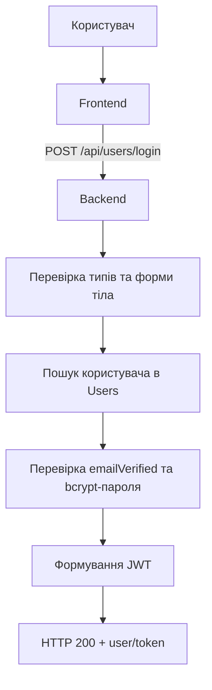

# SYS-API-02 — Вхід користувача

**Тип документа:** System Analysis / Functional & Technical Specification  
**Ідентифікатор:** SYS-API-02  
**Функціональний модуль:** Users / Authentication

## Загальний опис

Функція входу автентифікує користувача за email або username та паролем. Backend знаходить користувача в `Users`, перевіряє стан підтвердження email і звіряє пароль із bcrypt-хешем. Для підтвердженого користувача формується JWT із базовими правами звичайного користувача.

Email та username взаємовиключні: тіло запиту має містити рівно один ідентифікатор. Користувач із `emailVerified = false` не може увійти.

## Архітектура та послідовність взаємодії



## API-контракт та обробка вхідних параметрів

### Вхід користувача

**Endpoint:** `POST /api/users/login`  
**Content-Type:** `application/json`  
**Authorization:** не потрібен.

**Заголовки запиту:**

| Заголовок | Обов'язковість | Опис та обробка |
|---|---|---|
| Host | Автоматично | HTTP-клієнт надсилає адресу API-сервера; приклад: `localhost:3001` |
| Content-Type | Так для JSON-запиту | `application/json` |
| X-System-Code | Автоматично для Frontend | Frontend передає `front`; backend підставляє `front`, якщо заголовок відсутній. Інше передане значення приймається та додається до HTTP-логів і, для HTTP-методів POST/PUT/PATCH/DELETE, до `ApiAuditLogs` |
| X-Request-Id | Ні | UUID кореляції. Якщо заголовок відсутній або невалідний, backend генерує UUID і повертає його в response header та JSON-полі `requestId` |
| Authorization | Ні | Для входу не використовується |

**Request Body (один із варіантів):**

```json
{
  "user": {
    "email": "alex@example.com",
    "password": "Example!234"
  }
}
```

або `username` замість `email`.

| Параметр | Тип | Обов'язковість | Правила валідації та обробки | Збереження/використання |
|---|---|---|---|---|
| user | Object | Так | Контейнер; сторонні ключі не допускаються | — |
| user.email | String | Один із email/username | Email для пошуку користувача. Regex акаунта: `/^(?!.*[._+-]{2})[A-Za-z0-9._+-]+@[A-Za-z0-9](?:[A-Za-z0-9-]*[A-Za-z0-9])?(?:\.[A-Za-z0-9](?:[A-Za-z0-9-]*[A-Za-z0-9])?)+$/`; login endpoint перевіряє лише тип і повторно цей regex не запускає | Читання `Users.email` |
| user.username | String | Один із email/username | Username для пошуку. Regex акаунта: `/^[A-Za-z][A-Za-z0-9]{2,39}$/`; login endpoint перевіряє лише тип і повторно цей regex не запускає | Читання `Users.username` |
| user.password | String | Так | Пароль має бути рядком. Під час входу перевіряється bcrypt-відповідність; правила створення нового пароля тут не запускаються | Порівняння з `Users.password`, без запису |

Передавання обох ідентифікаторів одночасно, невідомих ключів або значення неправильного типу призводить до HTTP 422. Наведені regex описують правила створення акаунта; код входу виконує лише пошук після приведення ідентифікатора до нижнього регістру.

### Контекстна логіка Backend

Controller `signIn` спочатку перевіряє структуру JSON, allowlist ключів і типи. Потім обирає email або username, шукає користувача без урахування регістру після `trim()`, перевіряє `emailVerified` і порівнює наданий пароль із хешем через bcrypt. Токен формується лише після успішного проходження всіх перевірок.

| Ситуація | Результат поточного API | Чи видається JWT |
|---|---|---|
| Немає email/username або password | HTTP 422, валідаційна помилка | Ні |
| Передані email і username разом, стороннє поле або неправильний тип | HTTP 422 | Ні |
| Користувача не знайдено | HTTP 404 | Ні |
| Email ще не підтверджений | HTTP 422 | Ні |
| Пароль не відповідає bcrypt-хешу | HTTP 422 | Ні |
| Усі перевірки успішні | HTTP 200 з `user` і `token` | Так |

Пошук не застосовує форматні regex повторно: вхідний identifier обрізається по краях і переводиться в нижній регістр. Тому формат акаунта встановлюється під час реєстрації, а логін використовує збережений у `Users` ідентифікатор.

**Успішна відповідь — HTTP 200 OK:**

```json
{
  "user": {
    "email": "alex@example.com",
    "username": "alex",
    "bio": null,
    "image": null,
    "token": "<jwt>"
  },
  "requestId": "<uuid>"
}
```

У серіалізованій відповіді приховуються `id`, `password`, `createdAt`, `updatedAt` та `emailVerified`.

## Збереження даних та особливості моделі User

Endpoint читає обліковий запис із `Users`; пароль у запиті не зберігається. JWT повертається клієнту, але окремо в БД не записується. Вхід доступний лише для `emailVerified = true`.

## Авторизація, логування та аудит

Авторизація для самого запиту входу не потрібна. Для POST-запиту створюється HTTP-лог і рядок аудиту `ApiAuditLogs`; пароль маскується у payload. Подія входу не змінює рядок `Users`, тому DB mutation hook не спрацьовує. Логи несуть `requestId` та `systemCode`.

## Критерії приймання

- Валідний email або username разом із правильним паролем підтвердженого користувача повертає HTTP 200 і JWT.
- Не можна передати одночасно email і username.
- Не можна передавати сторонні поля або значення не того типу.
- Непідтверджений користувач не входить у систему.
- Пароль не повертається клієнту й маскується в аудиті.
- HTTP-виклик корелюється через `requestId` і містить `systemCode`.
