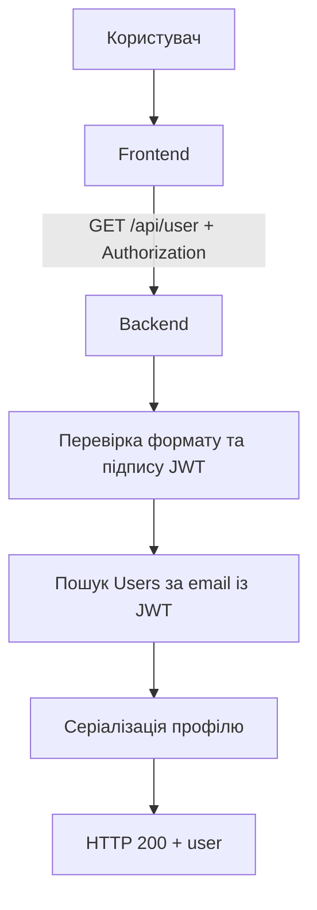

# SYS-API-03 — Отримання поточного користувача

**Тип документа:** System Analysis / Functional & Technical Specification  
**Ідентифікатор:** SYS-API-03  
**Функціональний модуль:** Users / Current User

## Загальний опис

Функція повертає профіль користувача, ідентифікованого JWT у заголовку `Authorization`. Запит використовується фронтендом для відновлення авторизованої сесії. Backend перевіряє токен, знаходить користувача за email із JWT та повертає публічні поля профілю разом із токеном.

## Архітектура та послідовність взаємодії



## API-контракт та обробка вхідних параметрів

### Отримання поточного користувача

**Endpoint:** `GET /api/user`  
**Request Body:** відсутнє.

**Заголовки запиту:**

| Параметр | Обов'язковість | Призначення та правила |
|---|---|---|
| Host | Автоматично | Адреса API-сервера |
| X-System-Code | Так для фронтенду | Frontend надсилає `front`; backend підставляє `front`, якщо заголовок відсутній. Інші значення приймаються й логуються |
| Authorization | Так | Формат `Token <JWT>`. Middleware очікує схему `Token`, один токен без додаткових частин і валідний JWT-підпис. Окремий regex для JWT не задається; токен перевіряється JWT-бібліотекою |
| X-Request-Id | Ні | UUID кореляції; за відсутності генерується backend |

У запиті немає параметрів шляху, query-параметрів або JSON-полів.

**Успішна відповідь — HTTP 200 OK:**

```json
{
  "user": {
    "email": "alex@example.com",
    "username": "alex",
    "bio": null,
    "image": null,
    "token": "<jwt>"
  },
  "requestId": "<uuid>"
}
```

Серіалізатор приховує `id`, `password`, часові поля та `emailVerified`. Email додається до відповіді з ідентифікатора перевіреного токена.

## Збереження даних та особливості моделі User

Запит тільки читає користувача з `Users`; жодні передані дані не записуються. Для пошуку використовується email із перевірених claims JWT. Токен повертається як частина відповіді, але не записується в БД.

## Авторизація, логування та аудит

JWT є обов'язковим. Відсутній або невалідний токен повертає HTTP 401. Для GET створюється HTTP-лог із методом, шляхом, статусом, тривалістю, `requestId`, `systemCode` і кількістю DB-запитів. Запис у `ApiAuditLogs` створюється лише для POST/PUT/PATCH/DELETE, тому для цього GET його немає. Значення SQL не логуються.

**Виявлена невідповідність реалізації:** middleware автентифікації використовує `UnauthorizedError`, але не імпортує цей клас. Тому відсутній токен, який доходить до контролера, дає HTTP 401, а невалідний/прострочений токен може завершитися HTTP 500 (`ReferenceError`). Вимога для API — повертати 401 в обох випадках; реалізацію middleware потрібно узгодити з цією вимогою.

## Критерії приймання

- Валідний JWT повертає профіль відповідного користувача з HTTP 200.
- Відсутній або невалідний JWT не надає доступу.
- Відповідь не містить пароля, первинного ключа чи стану верифікації.
- Читання не змінює дані у БД і не створює API audit row.
- Запит має кореляційний `requestId` і `systemCode` у логах.
