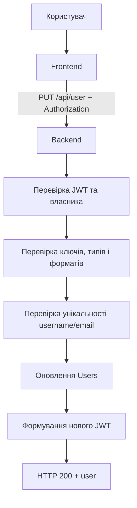

# SYS-API-04 — Оновлення профілю користувача

**Тип документа:** System Analysis / Functional & Technical Specification  
**Ідентифікатор:** SYS-API-04  
**Функціональний модуль:** Users / Current User

## Загальний опис

Авторизований користувач може оновити власні username, email, password, bio та image. Усі поля необов'язкові; зміна застосовується лише для переданих полів. Backend відхиляє сторонні ключі, перевіряє типи та доступ до унікального username/email. Після успішного оновлення повертається актуальний профіль і новий JWT.

## Архітектура та послідовність взаємодії



## API-контракт та обробка вхідних параметрів

### Оновлення користувача

**Endpoint:** `PUT /api/user`  
**Content-Type:** `application/json`  
**Authorization:** обов'язковий, формат `Token <JWT>`.

**Заголовки запиту:**

| Параметр | Обов'язковість | Призначення |
|---|---|---|
| Host | Автоматично | Адреса API-сервера |
| Content-Type | Так | `application/json` |
| X-System-Code | Так для фронтенду | Автоматичне значення `front`; відсутнє значення бекенд нормалізує до `front`; довільне надане значення приймається й логуються |
| Authorization | Так | `Token <JWT>`; JWT має пройти криптографічну перевірку |
| X-Request-Id | Ні | UUID для кореляції; генерується backend за потреби |

**Request Body:**

```json
{
  "user": {
    "username": "alex2",
    "email": "alex2@example.com",
    "password": "NewPass!234",
    "bio": "Оновлений опис",
    "image": "https://example.com/avatar.png"
  }
}
```

| Параметр | Тип | Обов'язковість | Призначення та правила | Збереження |
|---|---|---|---|---|
| user | Object | Так | Контейнер змін; сторонні ключі не допускаються | — |
| username | String | Ні | 3–40 символів; перший символ латинська літера, решта латинські літери або цифри. Regex: `/^[A-Za-z][A-Za-z0-9]{2,39}$/`. Значення має бути унікальним | `Users.username` |
| email | String | Ні | До 254 символів, формат перевіряється regex `/^(?!.*[._+-]{2})[A-Za-z0-9._+-]+@[A-Za-z0-9](?:[A-Za-z0-9-]*[A-Za-z0-9])?(?:\.[A-Za-z0-9](?:[A-Za-z0-9-]*[A-Za-z0-9])?)+$/`. Значення має бути унікальним | `Users.email` |
| password | String | Ні | Новий пароль: 8–30 символів ASCII, велика латинська літера, цифра й спеціальний символ. Перевірки: `/[^\x20-\x7E]/` не має збігатися, `/[A-Z]/`, `/[0-9]/`, `/[^A-Za-z0-9\s]/` мають збігатися. Порожній рядок поточний код ігнорує. Новий пароль має відрізнятися від поточного | `Users.password` як bcrypt-хеш |
| bio | String | Ні | До 9000 символів. Не допускаються пробіли на початку/в кінці або два й більше пробілів поспіль (`/ {2,}/`). `null` не приймається | `Users.bio` |
| image | String або null | Ні | До 2048 символів; має бути URL з протоколом `http:`/`https:` або data URL з префіксом `/^data:image\//i`. `null` очищає зображення | `Users.image` |

Email та username після успішної валідації нормалізуються до нижнього регістру. Повторний username/email, зайві ключі, неправильний тип або формат призводять до HTTP 422.

**Успішна відповідь — HTTP 200 OK:**

```json
{
  "user": {
    "email": "alex2@example.com",
    "username": "alex2",
    "bio": "Оновлений опис",
    "image": "https://example.com/avatar.png",
    "token": "<new-jwt>"
  },
  "requestId": "<uuid>"
}
```

## Збереження даних та особливості моделі User

Зміни записуються у відповідні стовпці таблиці `Users`. Пароль зберігається лише як bcrypt-хеш. Для username/email перевіряється відсутність іншого користувача з таким значенням; у таблиці також діють унікальні індекси. Після оновлення формується новий JWT.

## Авторизація, логування та аудит

JWT обов'язковий; користувач може змінювати тільки власний запис. HTTP-запит і payload записуються до `ApiAuditLogs`, де ключі password маскуються. Подія зміни Users також потрапляє до структурованого DB-логу з `system.code=db`. Логи корелюються за `requestId`.

## Критерії приймання

- Запит без валідного JWT відхиляється.
- Дозволено змінювати тільки поля username, email, password, bio, image.
- Regex, довжини та типи відповідають контракту; `bio: false` та `bio: null` відхиляються.
- Дублі username/email не зберігаються.
- Пароль у БД зберігається як хеш і маскується в API-аудиті.
- Після успішної зміни повертається профіль і новий JWT; запис та логування містять кореляційний ідентифікатор.
