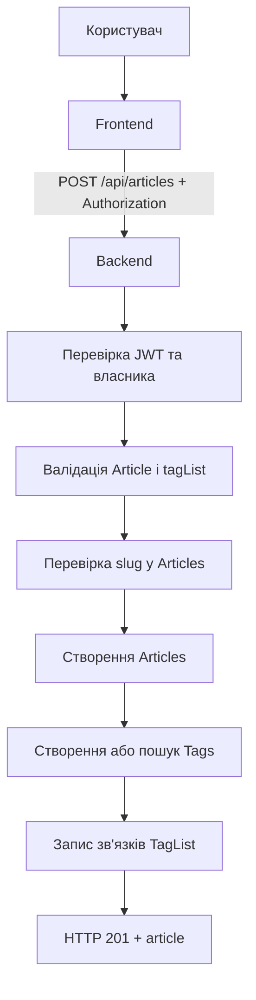

# SYS-API-05 — Створення статті

**Тип документа:** System Analysis / Functional & Technical Specification  
**Ідентифікатор:** SYS-API-05  
**Функціональний модуль:** Articles / Create Article

## Загальний опис

Функція створює статтю від імені автентифікованого користувача. Обов'язкові назва, короткий опис і текст статті; можна передати до десяти тегів. Backend перевіряє типи, межі довжини, пробіли та унікальність slug. Якщо slug зайнятий, API повертає HTTP 409; після підтвердження клієнтом дозволено повторити виклик із `allowDuplicateTitle: true`, тоді формується slug із числовим суфіксом.

## Архітектура та послідовність взаємодії



## API-контракт та обробка вхідних параметрів

### Створення статті

**Endpoint:** `POST /api/articles`  
**Content-Type:** `application/json`  
**Authorization:** обов'язковий, формат `Token <JWT>`.

**Заголовки запиту:**

| Параметр | Обов'язковість | Призначення |
|---|---|---|
| Host | Автоматично | Адреса API-сервера |
| Content-Type | Так | `application/json` |
| X-System-Code | Так для фронтенду | Frontend передає `front`; backend додає `front`, якщо заголовка немає. Інші значення дозволені й потрапляють до логів |
| Authorization | Так | `Token <JWT>`; токен визначає автора статті |
| X-Request-Id | Ні | UUID для трасування; за відсутності генерується сервером |

**Request Body:**

```json
{
  "article": {
    "title": "Моя перша стаття",
    "description": "Короткий опис",
    "body": "Текст статті має містити щонайменше двадцять символів.",
    "tagList": ["node", "api"],
    "allowDuplicateTitle": false
  }
}
```

| Параметр | Тип | Обов'язковість | Призначення та правила | Збереження |
|---|---|---|---|---|
| article | Object | Так | Контейнер; сторонні ключі не допускаються | — |
| title | String | Так | 5–240 символів після `trim`; не порожній. Заборонені пробіли на початку/в кінці та два й більше пробілів поспіль (`/ {2,}/`) | `Articles.title`; генерується `Articles.slug` |
| description | String | Так | 5–240 символів після `trim`; ті самі правила пробілів: `/ {2,}/` і точна відповідність значення його `trim()` | `Articles.description` |
| body | String | Так | 20–9000 символів після `trim`; ті самі правила пробілів: `/ {2,}/` і заборона початкових/кінцевих пробілів | `Articles.body` |
| tagList | Array<String> | Ні | Максимум 10; кожен елемент після обрізання пробілів і видалення початкових `#` має відповідати `/^[A-Za-z0-9_-]{1,30}$/`. Теги унікальні без урахування регістру. Порожній або відсутній список означає без тегів | `Tags.name`, зв'язки `TagList` |
| allowDuplicateTitle | Boolean | Ні | Дозволяє створити унікальний slug з суфіксом лише після підтвердження конфлікту. Інші типи відхиляються | Не зберігається як поле статті |

Для title, description і body окремий regex формату не застосовується; код перевіряє довжину, `trim()` та `/ {2,}/`. У query string цього endpoint параметри не передбачені.

**Успішна відповідь — HTTP 201 Created:**

```json
{
  "article": {
    "slug": "moia-persha-stattia",
    "title": "Моя перша стаття",
    "description": "Короткий опис",
    "body": "Текст статті має містити щонайменше двадцять символів.",
    "tagList": ["node", "api"],
    "author": { "username": "alex" },
    "favorited": false
  },
  "requestId": "<uuid>"
}
```

Якщо slug уже існує та `allowDuplicateTitle` не дорівнює `true`, повертається HTTP 409. Невалідні поля повертають HTTP 422; відсутня авторизація — HTTP 401.

## Збереження даних та особливості моделі Article

Запис статті додається до `Articles`, включно зі slug, title, description, body та зовнішнім ключем автора `userId`. Теги створюються за потреби в `Tags`; зв'язки статті з тегами записуються в `TagList`. `allowDuplicateTitle` є лише керівним параметром і не зберігається.

## Авторизація, логування та аудит

Автор статті визначається тільки за JWT; клієнт не може передати `authorId`. POST payload зберігається в `ApiAuditLogs`; паролі/токени маскуються, але текст статті в поточному механізмі не редагується. Створення Article і Tag потрапляє до структурованих DB-логів із `system.code=db`. Кожна подія має `requestId`.

## Критерії приймання

- Створення доступне тільки авторизованому користувачу.
- Обов'язкові поля, типи, довжини й пробіли перевіряються на бекенді.
- Теги перевіряються за regex, кількістю та унікальністю.
- Невідомі ключі й `allowDuplicateTitle` неправильного типу відхиляються.
- Схожий slug без підтвердження дає HTTP 409; підтверджене створення додає суфікс.
- Стаття, теги та зв'язки записуються до відповідних таблиць і логуються.
