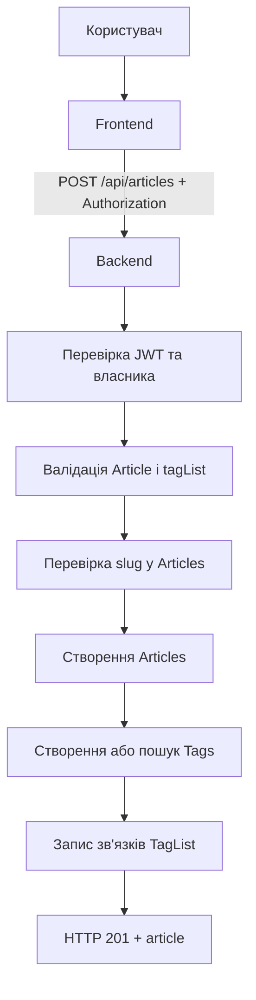

# SYS-API-05 — Створення статті

**Тип документа:** System Analysis / Functional & Technical Specification  
**Ідентифікатор:** SYS-API-05  
**Функціональний модуль:** Articles / Create Article

## Загальний опис

Функція створює статтю від імені автентифікованого користувача. Обов'язкові назва, короткий опис і текст статті; можна передати до десяти тегів. Backend перевіряє типи, межі довжини, пробіли та унікальність slug. Якщо slug зайнятий, API повертає HTTP 409; після підтвердження клієнтом дозволено повторити виклик із `allowDuplicateTitle: true`, тоді формується slug із числовим суфіксом.

## Архітектура та послідовність взаємодії



## API-контракт та обробка вхідних параметрів

### Створення статті

**Endpoint:** `POST /api/articles`  
**Content-Type:** `application/json`  
**Authorization:** обов'язковий, формат `Token <JWT>`.

**Заголовки запиту:**

| Заголовок | Обов'язковість | Опис та обробка |
|---|---|---|
| Host | Автоматично | HTTP-клієнт надсилає адресу API-сервера; приклад: `localhost:3001` |
| Content-Type | Так для JSON-запиту | `application/json` |
| X-System-Code | Автоматично для Frontend | Frontend передає `front`; backend підставляє `front`, якщо заголовок відсутній. Інше передане значення приймається та додається до HTTP-логів і, для HTTP-методів POST/PUT/PATCH/DELETE, до `ApiAuditLogs` |
| Authorization | Так | `Token <JWT>`; токен визначає автора статті |
| X-Request-Id | Ні | UUID кореляції. Якщо заголовок відсутній або невалідний, backend генерує UUID і повертає його в response header та JSON-полі `requestId` |

**Request Body:**

```json
{
  "article": {
    "title": "Моя перша стаття",
    "description": "Короткий опис",
    "body": "Текст статті має містити щонайменше двадцять символів.",
    "tagList": ["node", "api"],
    "allowDuplicateTitle": false
  }
}
```

| Параметр | Тип | Обов'язковість | Правила валідації та обробки | Збереження/використання |
|---|---|---|---|---|
| article | Object | Так | Контейнер; сторонні ключі не допускаються | — |
| title | String | Так | 5–240 символів після `trim`; не порожній. Заборонені пробіли на початку/в кінці та два й більше пробілів поспіль (`/ {2,}/`) | `Articles.title`; генерується `Articles.slug` |
| description | String | Так | 5–240 символів після `trim`; ті самі правила пробілів: `/ {2,}/` і точна відповідність значення його `trim()` | `Articles.description` |
| body | String | Так | 20–9000 символів після `trim`; ті самі правила пробілів: `/ {2,}/` і заборона початкових/кінцевих пробілів | `Articles.body` |
| tagList | Array<String> | Ні | Максимум 10; кожен елемент після обрізання пробілів і видалення початкових `#` має відповідати `/^[A-Za-z0-9_-]{1,30}$/`. Теги унікальні без урахування регістру. Порожній або відсутній список означає без тегів | `Tags.name`, зв'язки `TagList` |
| allowDuplicateTitle | Boolean | Ні | Дозволяє створити унікальний slug з суфіксом лише після підтвердження конфлікту. Інші типи відхиляються | Не зберігається як поле статті |

Для title, description і body окремий regex формату не застосовується; код перевіряє довжину, `trim()` та `/ {2,}/`. У query string цього endpoint параметри не передбачені.

### Контекстна логіка Backend

Запит проходить маршрут `POST /api/articles` у такому порядку:

1. Middleware `verifyToken` читає `Authorization: Token <JWT>`, перевіряє токен і завантажує автора з `Users`. Якщо користувача немає в контексті, controller завершує запит помилкою авторизації.
2. `createArticle` перевіряє, що верхній рівень містить тільки `article`, а всередині немає полів поза `title`, `description`, `body`, `tagList`, `allowDuplicateTitle`.
3. Валідатори перевіряють текстові поля та теги до будь-якого запису Article. `allowDuplicateTitle` допускається тільки як JSON boolean.
4. `slugify(title)` створює базовий slug: приводить назву до нижнього регістру, транслітерує підтримувані літери, замінює послідовності символів поза `a-z`/`0-9` на дефіс і прибирає дефіси з країв. Якщо після нормалізації slug порожній, використовується `article`.
5. Backend шукає точний збіг базового slug у `Articles.slug`. Перевіряється саме slug після нормалізації, а не рівність оригінального тексту title.
6. Після вибору вільного slug створюється запис Article; далі знаходяться або створюються теги та зв'язки `TagList`. Після цього запис прив'язується до автора з JWT, додаються обчислені поля автора й улюблених статей, і повертається відповідь.

Унікальність реалізована у двох місцях: попередній пошук у controller та унікальний індекс `Articles.slug` у БД. Попередній пошук формує зрозумілу відповідь 409; індекс захищає цілісність даних, якщо два запити проходять перевірку одночасно. Реалізація не об'єднує послідовність створення Article/Tags/TagList в одну явну транзакцію.

### Поведінка `allowDuplicateTitle`

| Передане значення | Базового slug ще немає | Базовий slug зайнятий |
|---|---|---|
| Поля немає | Створити з базовим slug | HTTP 409, запис не створюється |
| `false` | Створити з базовим slug | HTTP 409, запис не створюється |
| `true` | Створити з базовим slug без суфікса | Знайти перший вільний slug з числовим суфіксом, починаючи з `-2` |
| Значення не boolean, зокрема `"true"` або `null` | HTTP 422 | HTTP 422 |

`true` означає «дозволити створення при конфлікті», а не «завжди додавати суфікс». Приклад: якщо `hello-world` вільний, і з `true`, і без параметра буде створено `hello-world`. Якщо зайнятий тільки `hello-world`, підтверджений повторний запит створить `hello-world-2`. Якщо зайняті `hello-world`, `hello-world-2` і `hello-world-3`, буде обрано `hello-world-4`.

Backend не зберігає факт підтвердження користувача і не має окремого confirmation token. Показати попередження про конфлікт і повторити POST з `allowDuplicateTitle: true` після згоди користувача має клієнтська частина. Сам сервер прийме коректний boolean `true` без попереднього 409.

### Сценарії конфлікту та повторного виклику

1. Клієнт надсилає POST без `allowDuplicateTitle` або з `false`.
2. Якщо базовий slug зайнятий, Backend повертає HTTP 409 та не переходить до створення Article, Tag і TagList.
3. Клієнт показує користувачу підтвердження. Після згоди повторює той самий запит з `allowDuplicateTitle: true`.
4. Backend знову проводить валідацію і пошук. Якщо slug доступний, створює статтю з базовим slug; якщо конфлікт зберігається, обирає перший вільний суфікс.

Приклад відповіді HTTP 409:

```json
{
  "errors": {
    "body": ["Article with a similar Title already exists. Do you want to continue?"]
  },
  "requestId": "<uuid>"
}
```

Приклад повторного запиту після підтвердження:

```json
{
  "article": {
    "title": "Hello-world",
    "description": "Another version",
    "body": "The second article has enough text to pass validation.",
    "allowDuplicateTitle": true
  }
}
```

Якщо запит із `true` іде паралельно з іншим запитом на той самий вільний slug, обидва можуть побачити його вільним до вставки. Унікальний індекс БД відхилить одну вставку; поточний код не перетворює цю гонку на контрольований HTTP 409, тому можливий HTTP 500. Так само помилка на пізньому кроці створення тегів/зв'язків може залишити вже створений Article, оскільки транзакція явно не відкривається.

**Успішна відповідь — HTTP 201 Created:**

```json
{
  "article": {
    "slug": "moia-persha-stattia",
    "title": "Моя перша стаття",
    "description": "Короткий опис",
    "body": "Текст статті має містити щонайменше двадцять символів.",
    "tagList": ["node", "api"],
    "author": { "username": "alex" },
    "favorited": false
  },
  "requestId": "<uuid>"
}
```

Якщо slug уже існує та `allowDuplicateTitle` не дорівнює `true`, повертається HTTP 409. Невалідні поля повертають HTTP 422; відсутня авторизація — HTTP 401. У разі успішного дублювання назви slug буде унікальним, але сама назва статті може повторюватися.

## Збереження даних та особливості моделі Article

Запис статті додається до `Articles`, включно зі slug, title, description, body та зовнішнім ключем автора `userId`. Теги створюються за потреби в `Tags`; зв'язки статті з тегами записуються в `TagList`. `allowDuplicateTitle` є лише керівним параметром і не зберігається.

## Авторизація, логування та аудит

Автор статті визначається тільки за JWT; клієнт не може передати `authorId`. POST payload зберігається в `ApiAuditLogs`; паролі/токени маскуються, але текст статті в поточному механізмі не редагується. Створення Article і Tag потрапляє до структурованих DB-логів із `system.code=db`. Кожна подія має `requestId`.

## Критерії приймання

- Створення доступне тільки авторизованому користувачу.
- Обов'язкові поля, типи, довжини й пробіли перевіряються на бекенді.
- Теги перевіряються за regex, кількістю та унікальністю.
- Невідомі ключі й `allowDuplicateTitle` неправильного типу відхиляються.
- Схожий slug без підтвердження дає HTTP 409; підтверджене створення додає суфікс.
- Стаття, теги та зв'язки записуються до відповідних таблиць і логуються.
