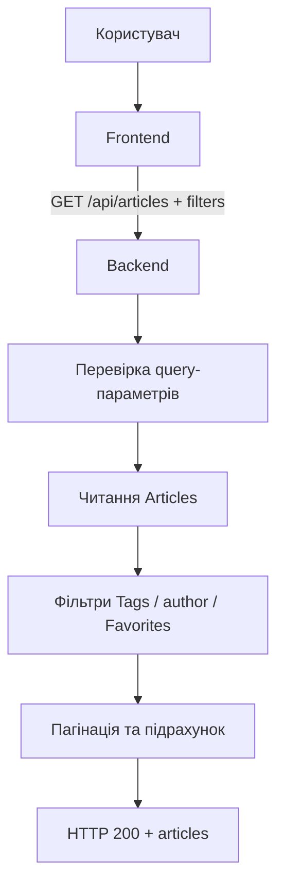

# SYS-API-06 — Перелік та фільтрація статей

**Тип документа:** System Analysis / Functional & Technical Specification  
**Ідентифікатор:** SYS-API-06  
**Функціональний модуль:** Articles / Article List

## Загальний опис

Функція повертає сторінку статей із необов'язковими фільтрами за тегом, автором і користувачем, який вподобав статті. Авторизація для читання необов'язкова. За наявності валідного JWT відповідь містить персоналізований стан `favorited` і відомості про автора; без токена публічні дані також доступні.

Пагінація використовує `limit` як розмір сторінки, а `offset` — як нульовий індекс сторінки, який множиться на `limit` для отримання SQL-зсуву.

## Архітектура та послідовність взаємодії



## API-контракт та обробка вхідних параметрів

### Отримання списку статей

**Endpoint:** `GET /api/articles`  
**Request Body:** відсутнє.  
**Authorization:** необов'язковий, якщо передано — `Token <JWT>`.

**Заголовки запиту:**

| Параметр | Обов'язковість | Призначення |
|---|---|---|
| Host | Автоматично | Адреса API-сервера |
| X-System-Code | Так для фронтенду | Frontend надсилає `front`; backend підставляє його за замовчуванням. Інші значення дозволені та логуються |
| Authorization | Ні | Необов'язковий токен для персоналізованого стану статті |
| X-Request-Id | Ні | UUID кореляції; за відсутності генерується backend |

**Query-параметри, приклад:** `GET /api/articles?tag=node&author=alex&favorited=alex&limit=10&offset=0`

| Параметр | Тип | Обов'язковість | Призначення та правила | Джерело даних |
|---|---|---|---|---|
| tag | String | Ні | Фільтр за назвою тегу. Окремий regex не застосовується; не-рядкові значення, зокрема повторений query-key у вигляді масиву, відхиляються | `Tags.name` / `TagList` |
| author | String | Ні | Фільтр за username автора; окремий regex не застосовується | `Users.username` |
| favorited | String | Ні | Username користувача, чиї вподобані статті треба повернути; окремий regex не застосовується | `Users.username`, `Favorites` |
| limit | Integer | Ні | Regex `/^\d+$/`; допустиме ціле число 1–50, типове значення 10 | Обмеження вибірки `Articles` |
| offset | Integer | Ні | Regex `/^\d+$/`; цілий невід'ємний індекс сторінки, типове значення 0. SQL offset дорівнює `offset × limit` | Зсув вибірки `Articles` |

Дозволені лише перелічені query-параметри; сторонні параметри повертають HTTP 422. Дробові числа, від'ємні значення, нечисловий рядок або значення поза діапазоном також відхиляються.

**Успішна відповідь — HTTP 200 OK:**

```json
{
  "articles": [
    {
      "slug": "hello-world",
      "title": "Hello world",
      "description": "Example description",
      "body": "Example article text.",
      "tagList": ["node"],
      "favorited": false,
      "author": { "username": "alex", "bio": null, "image": null, "following": false }
    }
  ],
  "articlesCount": 1,
  "requestId": "<uuid>"
}
```

`articlesCount` є кількістю результатів відповідного запиту, а не лише кількістю елементів поточної сторінки.

## Збереження даних та особливості моделі Article

Endpoint читає `Articles`, `Tags`, `TagList`, `Users` і, за потреби, `Favorites` та `Followers`. Нові записи не створюються. Для анонімного читання персоналізовані ознаки обчислюються без авторизованого користувача.

## Авторизація, логування та аудит

JWT необов'язковий. HTTP-запит логуються зі шляхом, query-параметрами, статусом, тривалістю, кількістю DB-запитів, `requestId` та `systemCode`. GET не створює запису в `ApiAuditLogs`. DB-логи містять тип операції та тривалість без значень SQL.

## Критерії приймання

- Список доступний без JWT; валідний JWT додає персоналізовані поля.
- Фільтри працюють незалежно або разом і приймають тільки рядки.
- `limit` обмежений діапазоном 1–50; `offset` — цілий невід'ємний індекс сторінки.
- Числові параметри перевіряються regex `/^\d+$/`; сторонні query-параметри відхиляються.
- Відповідь містить масив статей, загальну кількість результатів і `requestId`.
- GET не змінює дані та не створює API audit row.
