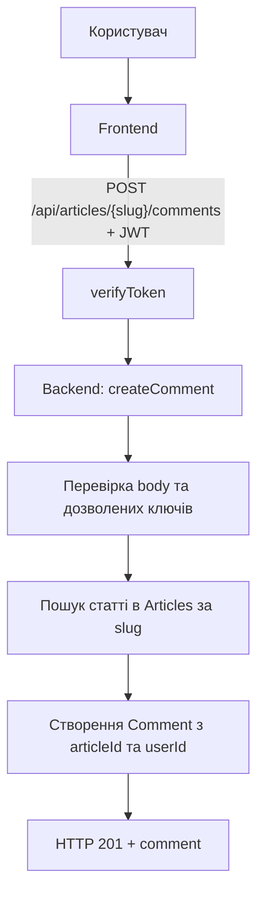

# SYS-API-07 — Створення коментаря

**Тип документа:** System Analysis / Functional & Technical Specification  
**Ідентифікатор:** SYS-API-07  
**Функціональний модуль:** Articles / Comments

## Загальний опис

Авторизований користувач додає коментар до статті, визначеної slug у URL. Автор коментаря та articleId беруться з перевіреного токена й знайденої статті; клієнт не передає ці значення в body. Після створення API повертає коментар із публічними даними автора.

## Архітектура та послідовність взаємодії



## API-контракт та обробка вхідних параметрів

### Створення коментаря

**Endpoint:** `POST /api/articles/{slug}/comments`  
**Content-Type:** `application/json`  
**Authorization:** обов'язковий, `Token <JWT>`.

| Заголовок | Обов'язковість | Опис та обробка |
|---|---|---|
| Host | Автоматично | HTTP-клієнт надсилає адресу API-сервера; приклад: `localhost:3001` |
| Content-Type | Так для JSON-запиту | `application/json` |
| X-System-Code | Автоматично для Frontend | Frontend передає `front`; backend підставляє `front`, якщо заголовок відсутній. Інше передане значення приймається та додається до HTTP-логів і, для HTTP-методів POST/PUT/PATCH/DELETE, до `ApiAuditLogs` |
| Authorization | Так | `Token <JWT>`; визначає автора коментаря |
| X-Request-Id | Ні | UUID кореляції. Якщо заголовок відсутній або невалідний, backend генерує UUID і повертає його в response header та JSON-полі `requestId` |

**Request:**

```http
POST /api/articles/hello-world/comments
```

```json
{
  "comment": {
    "body": "Дякую за корисну статтю."
  }
}
```

| Параметр | Тип | Обов'язковість | Правила валідації та обробки | Збереження/використання |
|---|---|---|---|---|
| slug | String | Так, path | Точне значення slug статті; окремий regex не заданий | Пошук `Articles.slug` |
| comment | Object | Так | Об'єкт має містити лише `body` | — |
| body | String | Так | Не може бути falsy; довжина до 9000 символів. Порожній рядок відхиляється як відсутній. Окремий regex, мінімальна довжина та `trim()` не застосовуються, тому рядок лише з пробілів наразі приймається | `Comments.body` |

Сторонні ключі як на рівні body, так і в `comment` повертають HTTP 422. Неправильний тип body або довжина понад 9000 також повертають HTTP 422. Відсутній/невалідний користувач — HTTP 401; невідомий slug — HTTP 404.

### Контекстна логіка Backend

Маршрут спочатку запускає `verifyToken`. Відсутній токен дозволяє middleware перейти далі, але controller вимагає `loggedUser` і завершує запит 401. Після цього `createComment` перевіряє allowlist JSON, перевіряє body, шукає статтю та створює `Comment` з `articleId: article.id` і `userId: loggedUser.id`. `commentId`, `articleId` чи `userId` від клієнта не приймаються.

Для невалідного або простроченого JWT діє дефект, описаний у SYS-API-03: middleware може повернути HTTP 500 замість очікуваного 401 через відсутній імпорт `UnauthorizedError`.

Якщо статті не знайдено, створення Comment не виконується. Після вставки модель пов'язується з автором для відповіді; токен видаляється з об'єкта автора перед серіалізацією. Створення одного коментаря не обгорнуте явною транзакцією.

**Успішна відповідь — HTTP 201 Created:**

```json
{
  "comment": {
    "id": 42,
    "body": "Дякую за корисну статтю.",
    "createdAt": "2026-11-16T12:00:00.000Z",
    "updatedAt": "2026-11-16T12:00:00.000Z",
    "author": {
      "username": "alex",
      "bio": null,
      "image": null,
      "following": false,
      "followersCount": 0
    }
  },
  "requestId": "<uuid>"
}
```

`Comment.toJSON()` виключає `articleId` і `userId`; ці внутрішні FK не повертаються.

## Збереження даних та особливості моделі Comment

Рядок зберігається в `Comments`: `body`, зовнішній ключ `articleId`, зовнішній ключ автора `userId`, первинний ключ `id` і стандартні timestamps Sequelize. Ідентифікатори зв'язків приховуються з API JSON. Автором завжди є власник JWT, не значення з request body.

## Авторизація, логування та аудит

POST створює рядок `ApiAuditLogs` зі шляхом, статусом, UUID, systemCode та payload. Текст коментаря зберігається в payload аудиту; поточна маска секретів його не приховує. Створення Comment реєструється DB hook як `db.record.create` з `system.code=db`. HTTP-лог включає статус, тривалість і кількість DB-запитів.

## Критерії приймання

- Створення доступне лише автентифікованому користувачу.
- Slug має відповідати наявній статті; неіснуюча стаття дає 404.
- Автор та articleId встановлюються на сервері; сторонні поля відхиляються.
- Body є рядком не довшим за 9000 символів; рядок з одних пробілів поточна реалізація приймає.
- Коментар зберігається в `Comments`, повертається з автором і без внутрішніх FK у JSON.
- HTTP audit та DB mutation log корелюються з `requestId`.
