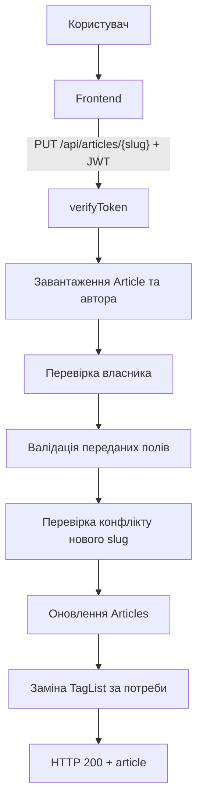

# SYS-API-08 — Оновлення статті

**Тип документа:** System Analysis / Functional & Technical Specification  
**Ідентифікатор:** SYS-API-08  
**Функціональний модуль:** Articles / Update Article

## Загальний опис

Авторизований автор статті може частково оновити title, description, body та/або tagList. Стаття визначається поточним slug у URL. Backend спочатку перевіряє існування статті та її власника, потім валідовує передані поля й зберігає зміни. Поля, яких немає у body, залишаються незмінними.

На відміну від створення статті, `PUT /api/articles/{slug}` не приймає `allowDuplicateTitle`: якщо новий title формує зайнятий slug, оновлення завершується HTTP 409.

## Архітектура та послідовність взаємодії



## API-контракт та обробка вхідних параметрів

### Оновлення статті

**Endpoint:** `PUT /api/articles/{slug}`  
**Content-Type:** `application/json`  
**Authorization:** обов'язковий, `Token <JWT>`.

| Заголовок | Обов'язковість | Опис та обробка |
|---|---|---|
| Host | Автоматично | HTTP-клієнт надсилає адресу API-сервера; приклад: `localhost:3001` |
| Content-Type | Так для JSON-запиту | `application/json` |
| X-System-Code | Автоматично для Frontend | Frontend передає `front`; backend підставляє `front`, якщо заголовок відсутній. Інше передане значення приймається та додається до HTTP-логів і, для HTTP-методів POST/PUT/PATCH/DELETE, до `ApiAuditLogs` |
| Authorization | Так | Токен визначає поточного користувача та його права на статтю |
| X-Request-Id | Ні | UUID кореляції. Якщо заголовок відсутній або невалідний, backend генерує UUID і повертає його в response header та JSON-полі `requestId` |

**Request Body:**

```json
{
  "article": {
    "title": "Оновлений заголовок",
    "description": "Оновлений опис",
    "body": "Оновлений текст статті, який проходить мінімальну довжину.",
    "tagList": ["backend", "api"]
  }
}
```

| Параметр | Тип | Обов'язковість | Правила валідації та обробки | Збереження/використання |
|---|---|---|---|---|
| slug | String | Так, path | Поточний slug статті; окремий regex не заданий | Пошук `Articles.slug` |
| article | Object | Так | Дозволені тільки title, description, body, tagList; зайві ключі, зокрема `allowDuplicateTitle`, відхиляються | — |
| title | String | Ні | Якщо переданий: 5–240 символів після trim, без пробілів на краях та повторних пробілів (`/ {2,}/`). Новий slug перевіряється на унікальність | `Articles.title`, `Articles.slug` |
| description | String | Ні | Якщо переданий: 5–240 символів після trim, без початкових/кінцевих пробілів та `/ {2,}/` | `Articles.description` |
| body | String | Ні | Якщо переданий: 20–9000 символів після trim, без початкових/кінцевих пробілів та `/ {2,}/` | `Articles.body` |
| tagList | Array<String> або null | Ні | Ті самі правила `normalizeTags`, що при створенні: до 10 унікальних тегів; `/^[A-Za-z0-9_-]{1,30}$/` після trim та видалення початкових `#`. Відсутнє поле зберігає поточні теги; `[]` або `null` очищає список | `Tags`, `TagList` |

Тіло `{ "article": {} }` допускається як no-op оновлення й виконує `save()` поточної моделі. Порожні рядки для текстових полів не проходять валідацію. Для title окремого прапорця підтвердження дубля немає.

### Контекстна логіка Backend

1. `verifyToken` встановлює `loggedUser`.
2. `updateArticle` знаходить Article за URL slug з автором і тегами. Не знайдений slug дає 404.
3. До перевірки body порівнюється `loggedUser.id` з id автора. Інший користувач отримує 403; автор статті є єдиним користувачем, якому дозволене оновлення.
4. Перевіряються форма `{article: ...}` та allowlist полів. Це означає, що клієнт не може передати `author`, `userId`, `slug`, `allowDuplicateTitle` або інші невідомі поля.
5. Для title обчислюється slug через ту саму `slugify`, що й для створення. Backend шукає цей slug; якщо його займає інша стаття — повертає 409. Збіг із поточною статтею дозволений, тому збереження без фактичної зміни назви не конфліктує.
6. `article.save()` зберігає Article. Якщо `tagList` присутній, backend знаходить або створює кожен Tag та замінює асоціації через `setTagList`; порожній список очищає зв'язки. Далі формуються поля автора/обраного для відповіді.

Для невалідного або простроченого JWT діє дефект, описаний у SYS-API-03: middleware може повернути HTTP 500 замість очікуваного 401.

**Успішна відповідь — HTTP 200 OK:**

```json
{
  "article": {
    "slug": "onovlenyi-zaholovok",
    "title": "Оновлений заголовок",
    "description": "Оновлений опис",
    "body": "Оновлений текст статті, який проходить мінімальну довжину.",
    "tagList": ["backend", "api"],
    "author": { "username": "alex", "following": false },
    "favorited": false
  },
  "requestId": "<uuid>"
}
```

Зміна title і тегів не об'єднана в явну транзакцію: помилка при створенні тегу або заміні асоціацій може статися після збереження основних полів статті. Конкурентна зміна title також захищається унікальним індексом slug, але гонка після попереднього пошуку може дійти до помилки БД, яку поточний controller окремо не перетворює на 409.

## Збереження даних та особливості моделі Article

Основні поля пишуться в `Articles`. При зміні title оновлюється також slug. При наявності `tagList` змінюються `Tags` (нові значення створюються за потреби) та junction table `TagList`. Автор не може бути змінений через цей API.

## Авторизація, логування та аудит

JWT обов'язковий; право змінювати визначається порівнянням автора з поточним користувачем. PUT payload додається до `ApiAuditLogs`; токени/паролі маскуються, поля статті ні. Зміна Article фіксується DB mutation log з `system.code=db`; запити та події корелюються за `requestId`.

## Критерії приймання

- Невідомий slug дає 404, неавторизований запит — 401, не-власник — 403.
- Сторонні поля, включно з `allowDuplicateTitle`, відхиляються.
- Часткове оновлення змінює тільки передані поля.
- Зайнятий slug іншої статті дає 409; поточний slug статті можна зберегти.
- `tagList` відсутній — зв'язки не змінюються; `[]` або `null` очищає їх; перелік тегів валідовується.
- Успішне оновлення повертає 200 та оновлену статтю з обчисленими метриками.
