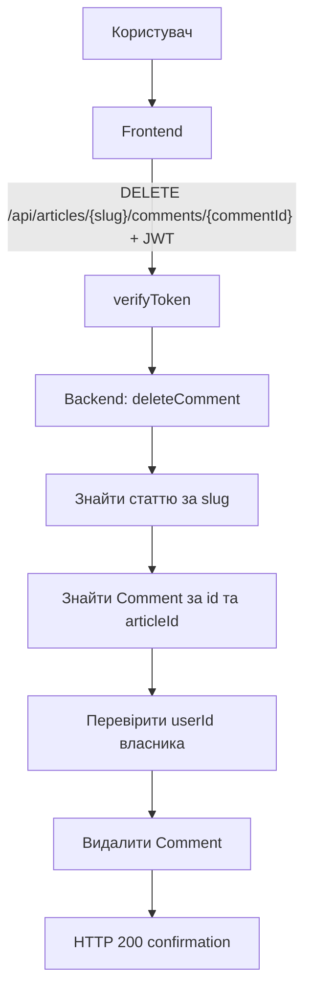

# SYS-API-09 — Видалення коментаря

**Тип документа:** System Analysis / Functional & Technical Specification  
**Ідентифікатор:** SYS-API-09  
**Функціональний модуль:** Articles / Comments

## Загальний опис

Авторизований користувач може видалити власний коментар зі статті. Запит адресує статтю через slug, а коментар через commentId. Коментар видаляється лише якщо він належить зазначеній статті та його `userId` збігається з id користувача з JWT. Автор статті не отримує окремого права видаляти коментарі інших користувачів.

## Архітектура та послідовність взаємодії



## API-контракт та обробка вхідних параметрів

### Видалення коментаря

**Endpoint:** `DELETE /api/articles/{slug}/comments/{commentId}`  
**Request Body:** відсутнє.  
**Authorization:** обов'язковий, `Token <JWT>`.

| Заголовок | Обов'язковість | Опис та обробка |
|---|---|---|
| Host | Автоматично | HTTP-клієнт надсилає адресу API-сервера; приклад: `localhost:3001` |
| X-System-Code | Автоматично для Frontend | Frontend передає `front`; backend підставляє `front`, якщо заголовок відсутній. Інше передане значення приймається та додається до HTTP-логів і, для HTTP-методів POST/PUT/PATCH/DELETE, до `ApiAuditLogs` |
| Authorization | Так | Визначає користувача, якому належить коментар |
| X-Request-Id | Ні | UUID кореляції. Якщо заголовок відсутній або невалідний, backend генерує UUID і повертає його в response header та JSON-полі `requestId` |

| Параметр | Тип | Обов'язковість | Правила валідації та обробки | Збереження/використання |
|---|---|---|---|---|
| slug | String | Так, path | Ідентифікатор статті; окремий regex не застосовується | Пошук `Articles.slug` |
| commentId | Integer | Так, path | Очікується первинний ключ коментаря. Controller передає значення до Sequelize без окремого regex/перевірки цілого числа | Пошук `Comments.id` |

Порядок перевірок: спочатку стаття, потім коментар із одночасними умовами `id=commentId` та `articleId=знайденої статті`, далі власник. Стаття не знайдена — 404 Article; коментар не знайдений або належить іншій статті — 404 Comment; коментар існує, але належить іншому користувачу — 403.

### Контекстна логіка Backend

Route middleware `verifyToken` визначає користувача, після чого controller `deleteComment` знаходить Article за slug. Пошук Comment обмежений ідентифікатором статті, тому передати commentId іншої статті недостатньо для видалення. Власність перевіряється точно за `loggedUser.id === comment.userId`; жодної ролі адміністратора чи винятку для автора статті ця операція не реалізує.

Після успішної перевірки виконується `comment.destroy()` — це фізичне видалення рядка, не встановлення soft-delete прапорця. Повторний запит після успішного видалення отримує 404 Comment.

Для невалідного або простроченого JWT діє дефект, описаний у SYS-API-03: middleware може повернути HTTP 500 замість очікуваного 401.

**Успішна відповідь — HTTP 200 OK:**

```json
{
  "message": {
    "body": ["Comment deleted successfully"]
  },
  "requestId": "<uuid>"
}
```

## Збереження даних та особливості моделі Comment

Видаляється рядок із `Comments` за первинним ключем. Інші коментарі статті та сам Article не змінюються. Payload body відсутній; фактичний об'єкт коментаря не повертається.

## Авторизація, логування та аудит

JWT обов'язковий. DELETE створює рядок `ApiAuditLogs`; `entityId` вибирається з path-параметра `commentId`, payload буде `null`, а запис містить метод, шлях, timestamp, request UUID, systemCode та статус. DB hook записує `db.record.destroy` із таблицею й id запису. Події HTTP і БД корелюються за `requestId`.

## Критерії приймання

- Без JWT операція не виконується.
- Перевіряються існування статті та коментаря саме в цій статті.
- Видаляти коментар може тільки його автор.
- Успіх фізично видаляє один рядок і повертає повідомлення з HTTP 200.
- Неіснуючі сутності дають 404, чужий коментар — 403.
- Створюються API audit і DB destroy logs із кореляційним ідентифікатором.
