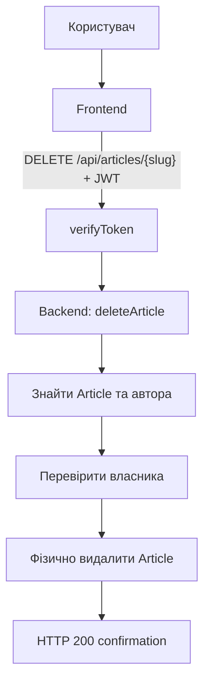

# SYS-API-10 — Видалення статті

**Тип документа:** System Analysis / Functional & Technical Specification  
**Ідентифікатор:** SYS-API-10  
**Функціональний модуль:** Articles / Delete Article

## Загальний опис

Авторизований користувач може видалити власну статтю за її slug. Backend завантажує статтю разом з автором, перевіряє власника, після чого виконує фізичне видалення запису Article. Невласник не може видалити статтю; адміністраторського винятку цей endpoint не має.

## Архітектура та послідовність взаємодії



## API-контракт та обробка вхідних параметрів

### Видалення статті

**Endpoint:** `DELETE /api/articles/{slug}`  
**Request Body:** відсутнє.  
**Authorization:** обов'язковий, `Token <JWT>`.

| Заголовок | Обов'язковість | Опис та обробка |
|---|---|---|
| Host | Автоматично | HTTP-клієнт надсилає адресу API-сервера; приклад: `localhost:3001` |
| X-System-Code | Автоматично для Frontend | Frontend передає `front`; backend підставляє `front`, якщо заголовок відсутній. Інше передане значення приймається та додається до HTTP-логів і, для HTTP-методів POST/PUT/PATCH/DELETE, до `ApiAuditLogs` |
| Authorization | Так | Визначає власника операції |
| X-Request-Id | Ні | UUID кореляції. Якщо заголовок відсутній або невалідний, backend генерує UUID і повертає його в response header та JSON-полі `requestId` |

| Параметр | Тип | Обов'язковість | Правила валідації та обробки | Збереження/використання |
|---|---|---|---|---|
| slug | String | Так, path | Slug статті; окремий regex не заданий | Пошук `Articles.slug` |

### Контекстна логіка Backend

1. Middleware `verifyToken` завантажує `loggedUser`.
2. Controller `deleteArticle` шукає Article за точним slug із включеним автором.
3. Після перевірки існування порівнюється `loggedUser.id` з `article.author.id`. Перевірка виконується до видалення.
4. Для власника викликається `article.destroy()`; це фізичне видалення рядка Article, а не soft delete.
5. За успіху controller повертає message response. Повторний DELETE того самого slug не є ідемпотентним за статусом: після першого видалення другий виклик поверне 404.

Модель Article має зв'язок із коментарями та junction tables для тегів і вподобань. Наслідки каскадного видалення цих пов'язаних рядків залежать від FK/асоціацій, створених поточною схемою Sequelize; контракт відповіді не повертає перелік видалених залежностей. Видалення не обгорнуте окремою транзакцією в controller.

Для невалідного або простроченого JWT діє дефект, описаний у SYS-API-03: middleware може повернути HTTP 500 замість очікуваного 401.

**Успішна відповідь — HTTP 200 OK:**

```json
{
  "message": {
    "body": ["Article deleted successfully"]
  },
  "requestId": "<uuid>"
}
```

Неіснуючий slug повертає HTTP 404. Якщо стаття існує, але належить іншому користувачу, повертається HTTP 403. Відсутня авторизація повертає HTTP 401.

## Збереження даних та особливості моделі Article

Рядок видаляється з `Articles`. У коді не видаляються напряму `Tags`: теги можуть бути спільними для інших статей. Власник та slug отримуються з БД, а не з request body.

## Авторизація, логування та аудит

DELETE додає рядок до `ApiAuditLogs`: entityId береться зі slug, payload порожній (`null`), зберігаються method, path, timestamp, UUID, systemCode і HTTP status. DB hook записує подію `db.record.destroy` із таблицею та id видаленого запису. Обидва логи корелюються за `requestId`.

## Критерії приймання

- Видалення можливе лише з валідним JWT власника статті.
- Невідомий slug повертає 404; спроба іншого користувача — 403.
- Успішний виклик фізично видаляє Article та повертає HTTP 200 з confirmation message.
- Request body не використовується для вибору автора чи запису.
- API audit і DB destroy log містять спільний `requestId`.
