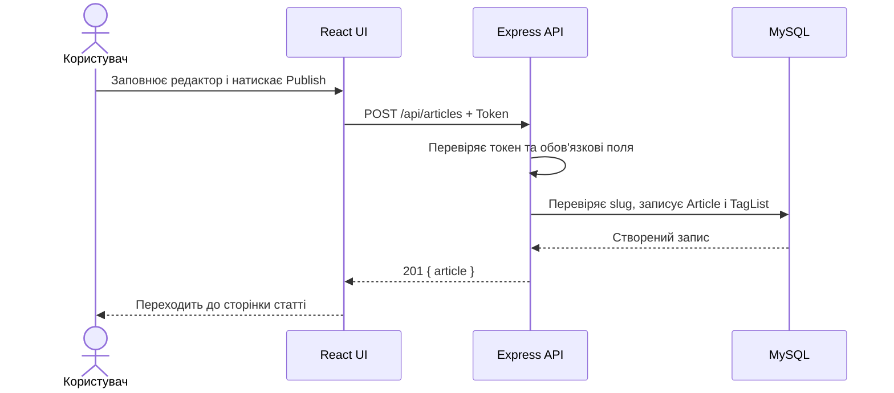
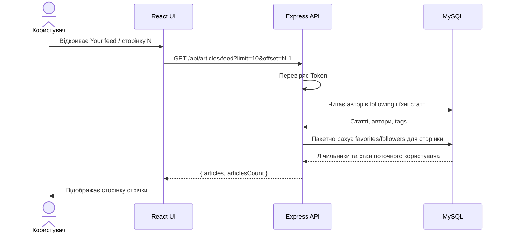
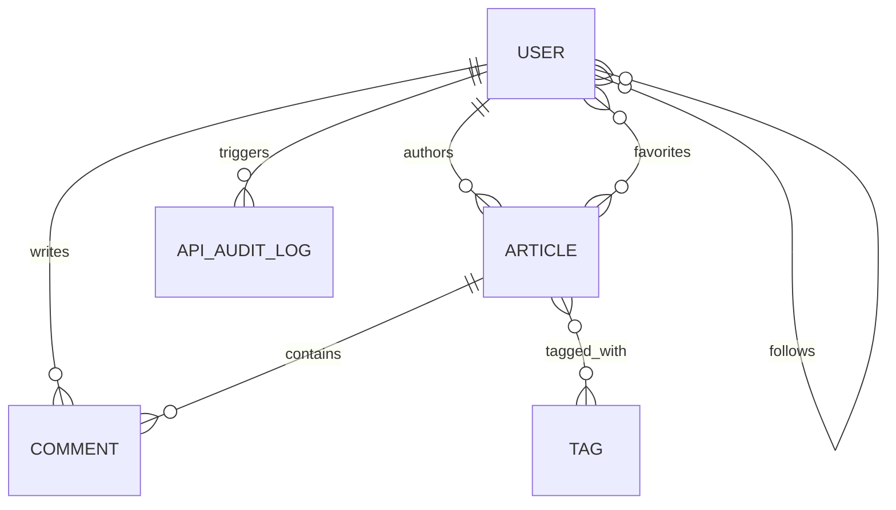

# Специфікація вимог Conduit

**Версія:** 1.0  
**Статус:** аналітична специфікація на основі наданих постановок і поточного коду  
**Мова:** українська

## 1. Призначення документа

Документ зводить у єдину структуру матеріали з `req/` та описує фактичні можливості поточної реалізації. Вимоги з вихідних постановок наведені першими. Функції, виявлені лише в коді, згруповані окремо в розділі 8. Невідповідність коду вимозі не означає, що вимогу скасовано.

Позначення:

- **REQ** — вимога з постановки у `req/`.
- **IMP** — функція, знайдена в поточному коді.
- **Статус:** `Реалізовано`, `Частково`, `Не реалізовано`, `Потребує уточнення`.
- Текст у квадратних дужках на кшталт **[уточнити]** фіксує відсутнє рішення, а не нав'язує поведінку.

## 2. Межі продукту та цілі

Conduit — вебзастосунок для публікації та читання статей, взаємодії з авторами й керування профілем. Надані матеріали охоплюють головну сторінку, реєстрацію, вхід, налаштування профілю та створення статті. Поточний код також містить перегляд і редагування статей, коментарі, підписки, обране, профілі й теги.

### 2.1 Актори

| Актор | Опис |
|---|---|
| Гість | Неавтентифікований відвідувач. Читає глобальну стрічку, статті, профілі й теги; може реєструватися або входити. |
| Користувач | Автентифікований користувач. Має функції гостя та може створювати контент, змінювати профіль, підписуватися, додавати статті в обране й коментувати. |
| Система | Перевіряє введення, автентифікує запити, зберігає дані та повертає результат клієнту. |

### 2.2 Основні припущення

1. Статус автентифікації передається API через `Authorization: Token <JWT>`.
2. Усі часові мітки зберігаються сервером; формат показу дати в інтерфейсі задає клієнт.
3. Реальний поштовий провайдер не налаштований. Реєстрація та відновлення пароля використовують mock-код `123456`, як передбачено тестовою постановкою.
4. Постановки не визначають ролі модератора/адміністратора, видалення акаунта, завантаження зображень чи вкладень; такі можливості не входять до підтвердженого обсягу.

## 3. Функціональні вимоги з постановок

### 3.1 Головна сторінка та стрічка

| ID | Вимога | Критерії приймання | Статус у коді |
|---|---|---|---|
| REQ-HOME-001 | Логотип Conduit і пункт Home відкривають головну сторінку. | Перехід з будь-якого розділу відкриває кореневий маршрут зі стрічкою. | Реалізовано |
| REQ-HOME-002 | Для гостя показується банер «Conduit — a place to share your knowledge». | Банер присутній на головній сторінці гостя. Точний український/англійський текст узгодити з дизайном. | Частково: є україномовний банер з іншим текстом |
| REQ-HOME-003 | Стрічка має вкладки Your feed (для користувача) та Global feed. | Гість бачить Global feed; користувач має доступ до обох вкладок. | Реалізовано; назви/умови відображення перевірити за UI |
| REQ-HOME-004 | Your feed містить статті авторів, на яких підписаний користувач. | Показуються тільки статті авторів зі списку following; порожній список відображає порожній стан. | Реалізовано |
| REQ-HOME-005 | Global feed містить усі статті від найновіших до найстаріших. | Порядок за часом створення спадний. | Реалізовано |
| REQ-HOME-006 | Під стрічкою є пагінація. | Користувач переходить між сторінками, результати відповідають вибраному номеру. | Реалізовано; параметр API `offset` є номером сторінки, а не кількістю пропущених рядків |
| REQ-HOME-007 | Показувати сторінки 1–50 і 10 статей на сторінку. | Рівно 10 записів на сторінці; доступні номери сторінок у межах заданого правила. | Реалізовано: UI запитує 10 статей та обмежує пагінацію 50 сторінками |
| REQ-HOME-008 | Картка статті показує аватар і username автора, дату DD.MM.YYYY, заголовок, опис, Read more і Like. | Усі поля відображаються в картці; дата відповідає формату. | Реалізовано |
| REQ-HOME-009 | Перехід за ім'ям автора відкриває його сторінку. | Клік на автора відкриває його профіль. | Реалізовано |
| REQ-HOME-010 | Перехід за заголовком, описом або Read more відкриває статтю. | Усі три клікабельні зони ведуть до тієї самої статті. | Реалізовано |
| REQ-HOME-011 | Лише користувач бачить кількість лайків і може ставити/знімати лайк. | Для гостя кількість прихована і дія недоступна; повторне натискання знімає лайк. | Реалізовано в UI/API |
| REQ-HOME-012 | Клік Like ставить лайк. | Лайк прив'язаний до користувача та статті; лічильник оновлюється. | Реалізовано як favorite |
| REQ-HOME-013 | Клік Like на вже вподобаній статті знімає лайк. | Повторна дія видаляє зв'язок обраного. | Реалізовано |
| REQ-HOME-014 | Праворуч від стрічки є Popular tags. | Блок присутній поруч зі стрічкою. | Реалізовано |
| REQ-HOME-015 | Вибір популярного тегу фільтрує статті за цим тегом. | Після вибору показуються тільки статті з тегом. | Реалізовано |

### 3.2 Реєстрація

| ID | Вимога | Критерії приймання | Статус у коді |
|---|---|---|---|
| REQ-AUTH-SU-001 | Гість може відкрити Sign Up з навігації. | Посилання доступне неавтентифікованому користувачу. | Реалізовано |
| REQ-AUTH-SU-002 | Форму можна відправити кнопкою або Enter. | Обидва способи запускають однакову валідацію й один запит. | Реалізовано |
| REQ-AUTH-SU-003 | За відсутності конфлікту створюється акаунт і надсилається лист верифікації. | Акаунт очікує підтвердження; лист містить код/посилання. | Частково: акаунт очікує підтвердження; реальний поштовий сервіс відсутній, використовується тестовий код |
| REQ-AUTH-SU-004 | Після реєстрації користувач переходить на Finish Registration і вводить 6-значний код. | Код перевіряється, помилка/успіх відображаються, акаунт активується після успіху. | Реалізовано з mock-кодом `123456` |
| REQ-AUTH-SU-005 | Є посилання Have an account? на Sign In. | Посилання переводить на екран входу. | Реалізовано |
| REQ-AUTH-SU-006 | Username обов'язковий, унікальний, 3–40 символів, латиниця та цифри, перший символ — літера, без пробілів/спецсимволів, нечутливий до регістру. | Межі включні; пробіли, керівні символи й спецсимволи відхиляються; порівняння регістру визначене. | Реалізовано у клієнті та API; зберігається у нижньому регістрі |
| REQ-AUTH-SU-007 | Email обов'язковий і унікальний; local-part підтримує латиницю, цифри, `+ - _ .`; формат `name@domain.tld`. | Невалідний формат і повторний email дають окремі помилки. | Реалізовано у клієнті та API; нормалізується у нижній регістр |
| REQ-AUTH-SU-008 | Password: 8–30 символів, щонайменше одна велика літера, цифра й спецсимвол; без керівних символів. | Клієнт і сервер однаково відхиляють пароль, що не відповідає правилам. | Реалізовано у клієнті та API; пароль хешується bcrypt |
| REQ-AUTH-SU-009 | Confirm password обов'язковий і збігається з password. | Розбіжність блокує відправлення; значення ніколи не потрапляє у лог. | Реалізовано у клієнті; не передається API |
| REQ-AUTH-SU-010 | Для зайнятого/невалідного username/email і пароля показуються задані повідомлення. | Кожна помилка пов'язана з відповідним полем та читабельна користувачу. | Реалізовано; серверні конфлікти прив'язуються до відповідного поля |

### 3.3 Вхід

| ID | Вимога | Критерії приймання | Статус у коді |
|---|---|---|---|
| REQ-AUTH-SI-001 | Sign In відкривається з навігації для гостя. | Гість може перейти до форми. | Реалізовано |
| REQ-AUTH-SI-002 | Форма має поле email або username, пароль і кнопку Sign In; submit через кнопку або Enter. | Поля доступні й мають зрозумілі мітки; Enter виконує submit. | Реалізовано |
| REQ-AUTH-SI-003 | Є Need an account? на Sign Up. | Перехід відкриває реєстрацію. | Реалізовано |
| REQ-AUTH-SI-004 | Є Forgot the password? на відновлення пароля. | Перехід відкриває сценарій відновлення. | Реалізовано з mock-кодом; email не надсилається |
| REQ-AUTH-SI-005 | Email/username обов'язковий, нечутливий до регістру; placeholder `Enter your username or email`. | Порожнє поле має inline-помилку; email/username нормалізується згідно правил. | Реалізовано у клієнті та API |
| REQ-AUTH-SI-006 | Пароль обов'язковий, маскується; copy/cut заборонені, paste дозволений. | Поле password маскується; перевірено keyboard і context menu. | Реалізовано у UI |
| REQ-AUTH-SI-007 | Порожні поля мають inline-повідомлення. | Повідомлення з'являється під відповідним полем до/після submit згідно UX. | Реалізовано |
| REQ-AUTH-SI-008 | Невідомий email/username і неправильний пароль мають різні повідомлення; з повідомлення про пароль можна перейти до відновлення. | Помилки відображаються без витоку чутливих даних; reset link доступний. | Реалізовано; відновлення працює з тестовим кодом `123456` |
| REQ-AUTH-SI-009 | Автентифікований користувач при відкритті Sign In переадресовується на свій профіль. | Пряме відкриття маршруту не лишає користувача на формі. | Реалізовано |

### 3.4 Створення статті

| ID | Вимога | Критерії приймання | Статус у коді |
|---|---|---|---|
| REQ-ART-NEW-001 | Зареєстрований користувач створює статтю. | Валідна форма створює статтю, що доступна у стрічці й профілі автора. | Реалізовано |
| REQ-ART-NEW-002 | Перехід доступний у навігації між Home і Settings. | Посилання показується авторизованому користувачу. | Реалізовано |
| REQ-ART-NEW-003 | Гість, що відкрив редактор напряму, переходить на Sign In. | Перенаправлення працює для прямого URL. | Реалізовано |
| REQ-ART-NEW-004 | Поля: Article Title, What's this article about?, Write your article; tags необов'язкові. | Форма має три обов'язкових поля й optional tags. | Реалізовано |
| REQ-ART-NEW-005 | Заголовок обов'язковий, 5–240 символів; дозволені літери/цифри/символи; пробіли не можуть бути крайніми чи повторюватися; схожий заголовок показує попередження. | Довжина/формат перевіряються; конфлікт не втрачає введений текст; рішення про продовження явне. | Реалізовано; дубльований slug викликає підтвердження, продовження створює унікальний slug |
| REQ-ART-NEW-006 | Description обов'язковий, 5–240 символів із правилами пробілів. | Сервер і UI узгоджено перевіряють межі. | Реалізовано у клієнті та API |
| REQ-ART-NEW-007 | Body обов'язковий, 20–9000 символів; вкладення не приймаються; поле можна змінювати за розміром. | Межі перевіряються; upload не пропонується; textarea resize доступний. | Реалізовано; вкладення не приймаються, textarea можна змінити вертикально |
| REQ-ART-NEW-008 | Tags необов'язкові; 2–30 символів, літери/цифри з необов'язковим `#` на початку; до 10; без урахування регістру. | Нормалізація й ліміт однакові на клієнті та сервері. | Реалізовано у клієнті та API; перед збереженням регістр зводиться до нижнього |
| REQ-ART-NEW-009 | Публікація кнопкою Publish Article або Enter. | Підтримуються клавіатурне й кнопкове відправлення без дубльованого submit. | Реалізовано через submit форми |
| REQ-ART-NEW-010 | Помилки обов'язкових полів показуються під ними. | Inline повідомлення доступні та прив'язані до полів. | Реалізовано |
| REQ-ART-NEW-011 | Вихід з редактора без публікації очищує введення. | Після повернення форма порожня. | Реалізовано: стан форми локальний для екрану й не зберігається при переході |
| REQ-ART-NEW-012 | Після успіху відкривається сторінка статті. | Користувач потрапляє на нову статтю. | Реалізовано |

### 3.5 Налаштування профілю

| ID | Вимога | Критерії приймання | Статус у коді |
|---|---|---|---|
| REQ-SET-001 | Авторизований користувач може редагувати власний профіль. | Успішне збереження оновлює профіль і стан інтерфейсу. | Реалізовано |
| REQ-SET-002 | Settings доступний із навігації авторизованому користувачу. | Посилання присутнє у відповідному меню. | Реалізовано |
| REQ-SET-003 | Гість при прямому відкритті Settings переходить на Sign In. | Auth guard виконує redirect. | Реалізовано |
| REQ-SET-004 | Поля: username, email, URL зображення, коротка біографія, новий пароль. | Основні поля відображають поточні значення; image/bio/password необов'язкові. | Реалізовано |
| REQ-SET-005 | Image URL необов'язковий; має бути URL; помилка `URL of profile picture is invalid`. | Некоректне значення не зберігається; валідне відображається у навігації та профілі. | Реалізовано у клієнті та API |
| REQ-SET-006 | Username відповідає правилам реєстрації та лишається унікальним. | Політика username однакова в реєстрації й налаштуваннях. | Реалізовано у клієнті та API |
| REQ-SET-007 | Bio необов'язкова, до 9000 символів. | Надлишок відхиляється, bio показується під ім'ям у профілі. | Реалізовано у клієнті та API |
| REQ-SET-008 | Email валідний і унікальний; після зміни вхід працює тільки з новим email. | Після успішного збереження новий email чинний, старий не автентифікує. | Реалізовано у клієнті та API |
| REQ-SET-009 | Новий пароль необов'язковий, 8–30 символів, містить велику літеру/цифру/спецсимвол і відрізняється від попереднього. | Пароль хешується; старий не працює, новий працює. | Реалізовано у клієнті та API |
| REQ-SET-010 | Update Settings перевіряє поля та зберігає валідні значення. | Помилки пояснюють поле; дані не змінюються при невалідній формі. | Реалізовано |
| REQ-SET-011 | Оновлені аватар/username видно в навігації; bio — у профілі. | UI оновлюється без повторного входу. | Реалізовано через оновлення auth state |
| REQ-SET-012 | Logout доступний під формою; після кліку перехід на Home і вихід з акаунта. | Токен/стан сесії очищено; гість бачить Home. | Реалізовано |

## 4. Наскрізні правила та вимоги до якості

Ці пункти є аналітичним оформленням наданих постановок; значення, яких немає у вихідних матеріалах, позначені як питання.

| ID | Вимога | Критерій / відкрите питання |
|---|---|---|
| NFR-SEC-001 | Паролі зберігаються лише як криптографічні хеші; пароль і токен не потрапляють у журнали. | У коді використовується bcrypt з cost 10. Перевірити маскування всіх логерів та імпортованих payloads. |
| NFR-SEC-002 | Захищені операції вимагають валідний bearer-токен; доступ перевіряється на сервері. | Поточний формат — `Token`, а не стандартний `Bearer`; уніфікувати контракт або документувати. |
| NFR-SEC-003 | Валідація виконується на API, не лише у браузері. | Поточна серверна валідація полів обмежена; див. gaps у §9. |
| NFR-API-001 | API повертає JSON у RealWorld-форматі з envelope-об'єктами `user`, `article`, `articles`, тощо. | Описано OpenAPI у `docs/api/openapi.yaml`. |
| NFR-API-002 | Для списків є обмежені параметри пагінації. | API обмежує `limit` до 1–50; `offset` — індекс сторінки, множиться на limit. Розглянути перейменування на `page`. |
| NFR-OBS-001 | HTTP-запит має кореляційний UUID, що можна використати для пошуку логів. | API приймає/створює request ID; повертає `X-Request-Id`; аудит змін записує UUID. |
| NFR-OPS-001 | Стан бази має переживати повторний запуск контейнерів. | Для тестового розгортання зберігати MySQL у persistent volume та робити резервні копії. |
| NFR-UX-001 | Форми мають доступні мітки, зв'язок помилки з полем і клавіатурне керування. | Вихідні постановки вимагають inline validation та Enter-submit; конкретні вимоги WCAG узгодити окремо. |

## 5. Основні сценарії

### 5.1 Публікація статті

**Передумови:** користувач увійшов у систему.  
**Основний потік:** відкрити редактор → заповнити обов'язкові поля й tags за потреби → відправити → сервер перевіряє дані та унікальність slug → запис і зв'язки tags збережено → клієнт відкриває сторінку статті.  
**Альтернативи:** неавторизований користувач переходить до входу; невалідне поле показує помилку; конфлікт заголовка/slug вимагає узгодженого UX; помилка БД повертається як серверна помилка.



### 5.2 Отримання персональної стрічки



## 6. Модель предметної області



`API_AUDIT_LOG` у поточній реалізації не має явного FK на користувача; зв'язок у діаграмі є логічним, не реляційним. Основні таблиці зв'язків у Sequelize: `TagList`, `Favorites`, `Followers`. Унікальність username/email перевіряється без урахування регістру й значення зберігаються у нижньому регістрі; slug зберігає title-derived формат із суфіксом для підтверджених дублікатів.

## 7. API та формати даних

Інтерактивна специфікація: [`docs/api/openapi.yaml`](../api/openapi.yaml).  
Swagger UI (після запуску backend): `/api-docs`.  
JSON readiness endpoint: `GET /health`.

### 7.1 Поширений формат помилки

```json
{"errors":{"body":["User not found"]}}
```

Статуси, які формує глобальний error handler: 401, 403, 404, 422; інші помилки отримують 500. Точні повідомлення залежать від помилки контролера.

### 7.2 Важливі API-відмінності від постановок

- Login приймає `user.email` або `user.username` разом із password; identifier нечутливий до регістру.
- Реєстрація створює непідтверджений акаунт; endpoint verification перевіряє тестовий код `123456`, після чого видає JWT. Реального листа немає.
- `GET /api/articles` дозволяє гостям і авторизованим користувачам; `GET /api/articles/feed` потребує токен.
- У `GET /api/articles`, `offset` означає номер сторінки з нуля, не SQL row offset.
- `limit` за замовчуванням 10, clamp до 1–50.
- Фільтри статей: `author`, `tag`, `favorited`.
- Favorite у API є еквівалентом Like у UI: `POST` додає, `DELETE` прибирає.
- `GET /api/tags` повертає до 20 тегів, відсортованих за кількістю статей.
- У відповіді гостю `favoritesCount` прихований (`null`); UI не показує кнопку активною та не показує лічильник.

## 8. Функції, знайдені в реалізації, але не визначені у наданих постановках

Ці функції описують поточний обсяг, а не додають заднім числом вимоги до початкових екранів.

| ID | Реалізована можливість | Поточна поведінка |
|---|---|---|
| IMP-ART-READ | Перегляд статті за slug | `GET /api/articles/{slug}` повертає текст, tags, автора, favorites count і прапорці взаємодії |
| IMP-ART-EDIT | Редагування статті | Автор може змінити title/description/body; slug перераховується при зміні title |
| IMP-ART-DELETE | Видалення статті | Видаляє власну статтю; для чужої повертає 403 |
| IMP-COMMENT | Перегляд, додавання й видалення коментарів | Додавати може авторизований користувач; видаляти може автор коментаря |
| IMP-PROFILE | Профіль, підписка та відписка | Є `GET/POST/DELETE /api/profiles/{username}` і UI-профіль автора |
| IMP-FAVORITE | Список обраного та toggle обраного | Підтримується через `favorited` query та favorite endpoint |
| IMP-TAG | Список тегів і фільтрація | `GET /api/tags`, `GET /api/articles?tag=...` |
| IMP-AUTH-CURRENT | Поточний користувач і редагування його профілю | `GET/PUT /api/user`; JWT-запит повертає user envelope |
| IMP-PAGINATION | Пагінація списку статей | `limit` і сторінковий `offset`; feed/global/author/favorite/tag listings |
| IMP-OBS-REQUEST | Кореляція запитів | UUID request ID, заголовок `X-Request-Id`, structured logs |
| IMP-OBS-AUDIT | Аудит POST/PATCH/DELETE змін | `ApiAuditLogs`: метод, шлях, payload, час, UUID, статус; чутливі поля маскуються логером |
| IMP-OBS-DB | Логування SQL метаданих | DB operation/duration та повільні запити; SQL values не повинні потрапляти в лог |
| IMP-SEED | Демо-дані | Локальне середовище створює/доповнює 50 статей, 10 авторів та коментарі |

## 9. Виявлені розбіжності та питання для продуктового рішення

### 9.1 Вимоги, що мають бути вирішені до повного приймання

1. **Email delivery:** для тестового середовища діє mock-код `123456`; якщо застосунок стане публічним, узгодити поштовий провайдер, строк дії та ліміт спроб.
2. **Пагінація:** після 500-ї статті UI не показує сторінки за межами 50; визначити, чи це остаточний продуктовий ліміт.
3. **Схожий заголовок:** поточна перевірка вважає схожими статті з однаковим slug; визначити, чи потрібне семантичне порівняння.
4. **Неповні linked specs:** вимоги до username/email у Settings посилаються на інший документ, а сторінка Article — на зовнішні Google Docs. Вміст цих матеріалів відсутній у `req/`.

### 9.2 Технічні ризики реалізації, що впливають на вимоги

- Код верифікації/відновлення пароля статичний і призначений тільки для тестового середовища; немає строку дії, ліміту спроб чи реальної доставки.
- Під час старту API ідемпотентно додає `Users.emailVerified` із default `true`, щоб зберегти доступ існуючих акаунтів; нові реєстрації явно створюються як непідтверджені.
- Публічні endpoint-и не мають rate limiting; додати його перед відкритим production запуском.
- Перевірка схожості заголовка покриває slug-конфлікт, а не fuzzy similarity.
- Схема БД у production синхронізується без `alter`; для еволюції схеми потрібні міграції й правила сумісного rollout.

## 10. Матриця простежуваності

| Пакет вимог | Джерело | Реалізація/API | Статус узагальнено |
|---|---|---|---|
| REQ-HOME | `req/Copy of Requirements_ Home page.md` | Home, feed, article/tag APIs | Основні критерії реалізовані; банер має україномовний варіант |
| REQ-AUTH-SU | `req/Copy of Refinement_ Sign Up Story.md` | SignUp, `POST /api/users`, `POST /api/users/verify-email` | Реалізовано з mock-кодом; реальний email delivery відсутній |
| REQ-AUTH-SI | `req/Copy of Refinement_ Sign In Story.md` | Login, forgot/reset password APIs | Реалізовано з mock-кодом |
| REQ-ART-NEW | `req/Copy of Requirements_ New Post screen.md` | ArticleEditor, `POST /api/articles` | Клієнтська й серверна валідація; duplicate-slug confirmation |
| REQ-SET | `req/Copy of Requirements_ Settings screen.md` | Settings, `GET/PUT /api/user` | Валідація та оновлення реалізовані |
| IMP-* | Поточний код backend/frontend | OpenAPI endpoints та UI | Описано окремо у §8 |

## 11. Поза межами підтверджених вимог

Не вважати реалізованими без окремої постановки: реальна відправка email, адміністрування/модерація, завантаження файлів, соціальний login, rate limit, account deletion, повноцінна HA/zero-downtime deployment.

